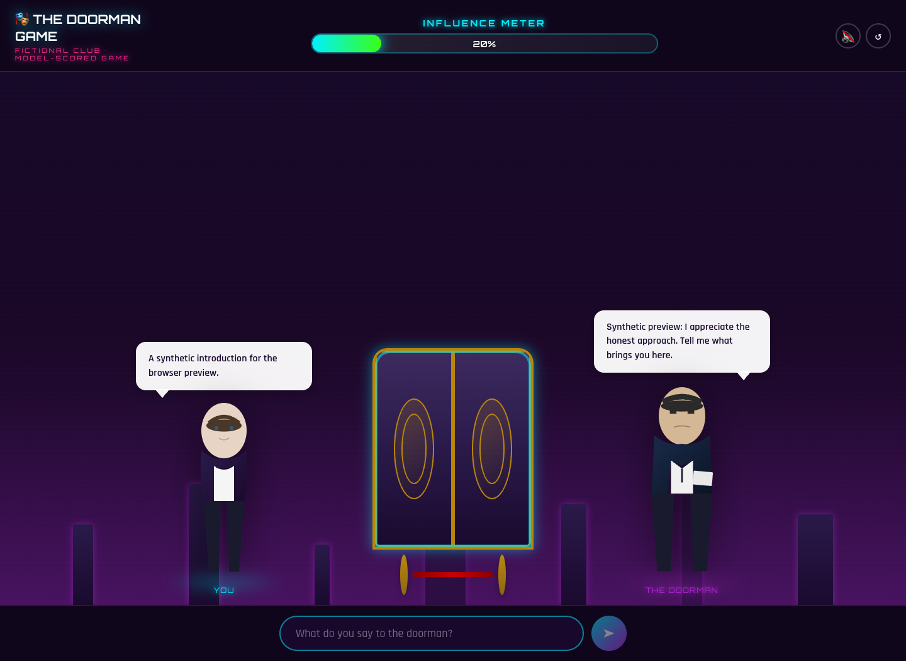
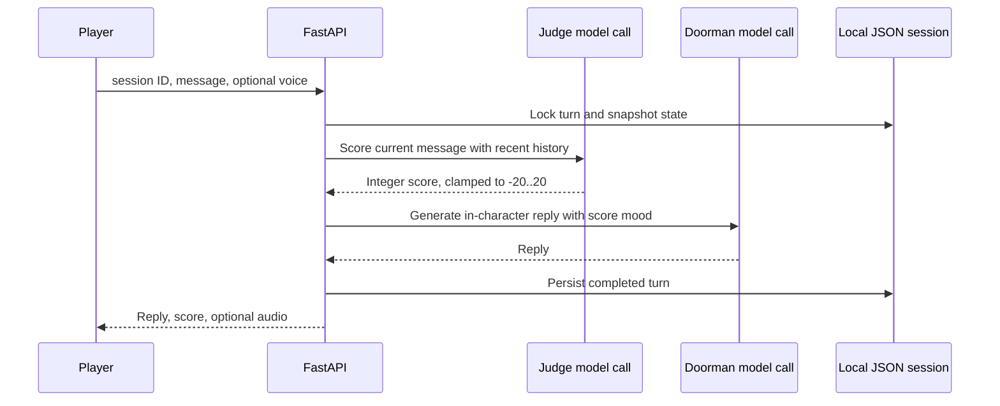

# The Doorman Game

A fictional conversation game: persuade a character to let you into an imaginary club. One model call scores the latest message, a second generates the doorman's reply, and optional text-to-speech adds voice. The score is a game mechanic, not a validated measure of persuasion or real-world behavior.



The preview uses intercepted synthetic dialogue and scores; no model response was generated for the screenshot. [Mobile preview](docs/game-mobile.png) uses a fresh session. The stage and characters are built from local UI assets/CSS. Voice starts off, errors preserve the message draft, and victory music uses manual controls rather than autoplay.

## Turn flow



Failed turns restore the previous score/history. Text-to-speech is an optional service call, not a third reasoning agent. The evaluator's raw analysis/backstory is not returned to the browser; the legacy `reasoning` response field contains a fixed summary. User instructions can still influence model behavior, and no adversarial robustness or grounding result is claimed.

## Local setup

Use Python 3.11+ and Node.js 22. The backend reads its local `.env`; configure your own private Venice key only when deliberately testing generation:

```sh
cd backend
python3 -m venv .venv
source .venv/bin/activate
pip install -r requirements.txt
cp .env.example .env
uvicorn app.main:app --host 127.0.0.1 --port 8000
```

In another terminal:

```sh
cd frontend
npm ci --ignore-scripts
cp .env.example .env.local
npm run dev
```

Open `http://localhost:5173`. `VITE_API_BASE` defaults to `http://127.0.0.1:8000`; it is public configuration, never a provider key. `DOORMAN_SESSION_DIR` optionally selects a private local session directory. JSON files contain message history in plaintext and are ignored by Git. Starting the backend does not invoke the provider. The legacy model identifiers in `backend/app/routes.py` were not verified against a live model catalogue.

## API contract

| Request | Behavior |
| --- | --- |
| `GET /test-env` | Local status and whether a provider key is configured; no provider request |
| `POST /chat` | One turn from `session_id`, `message`, optional `enable_tts` (default false) |
| `GET /session/{id}` | Restore/create session state and history |
| `POST /session/reset?session_id=...` | Reset that session |

The public session-enumeration endpoint was removed. Session IDs must be 16–128 ASCII letters, digits, underscores, or hyphens; invalid IDs are rejected rather than silently renamed. The browser uses `crypto.randomUUID()`. Knowing an ID still grants access to that session: this is a capability-style local demo, not authenticated multi-user account isolation.

Messages are limited to 2,000 characters. Influence bottoms out at -50 and access is granted at 100. Invalid judge JSON/types become a neutral score; valid integer scores are clamped to -20..20. Voice failure is optional and does not discard a successful text reply. Provider errors return generic messages, and redirects are disabled on generation requests.

## Verification

```sh
cd backend
pip install -r requirements-test.txt
python -m pytest -q
cd ../frontend
npm run build
npm run lint
```

Eight offline backend tests pass: local status/no enumeration, ID validation, persisted rollback after failure, five-turn winning state, malformed judge output/clamping, hidden-think filtering, input limits before agent calls, and generic provider errors. Files use a temporary test directory; no existing sessions are read.

The Vite production build and ESLint pass. Chrome verified synthetic session restoration, opt-in voice, sending, failed-draft retention and retry, five-turn victory, manual audio, reset, desktop/390px layout, and no page errors. No live Venice account, text model, speech model, generated audio, or model performance evaluation was used.

## Engineering limits

A process-wide lock serializes local chat turns; this supports a single-process demonstration and is not a multi-worker transaction system. JSON writes are atomic replacements but are not fsync durability guarantees. Session files/history/cache, request sizes beyond field validation, and audio/model response sizes still need operational bounds. Cleanup is not scheduled. Provider calls are synchronous with separate timeouts, and a browser timeout does not cancel already-running server/provider work.

Before hosting, define authenticated ownership and retention, add rate/cost/concurrency limits, and move state to a transactional store. A useful agentic-AI portfolio extension is a small fixture-based scoring/tool-contract evaluation, rather than calling the game a production multi-agent system or inventing success rates.
